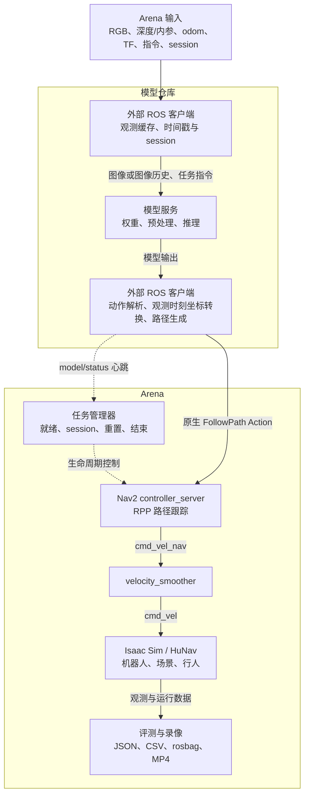
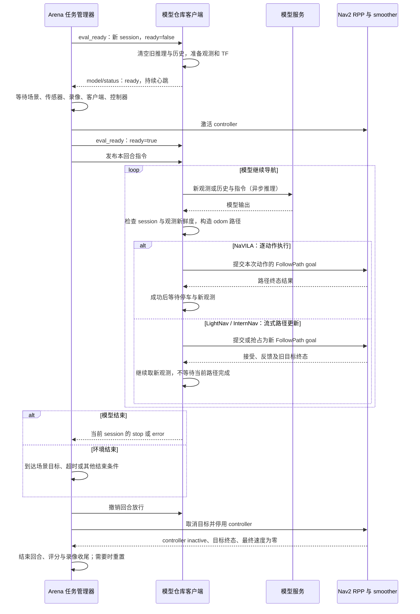

# 模型接入与评估

本文是 Arena 模型接入、部署、运行评测和结果检查的统一入口。模型仓库产生路径，Arena 使用原生 Nav2 `FollowPath` 和 Regulated Pure Pursuit（RPP）执行路径，并管理仿真、回合、评分与录像。

## 当前适配状态

截至 2026-10-11，三个模型均已接入 Arena 的统一路径执行链，实景任务结果分别记录：

| 模型 | Arena 公共入口与配置 | 模型客户端适配 | 真实场景验证 |
| --- | --- | --- | --- |
| NaVILA | 已有 | 已完成，已推送适配分支 | 已完成闭环；本次导航任务未成功 |
| InternNav | 已有 | 已完成，已推送适配分支 | 已完成闭环；导航及社会安全评分未通过 |
| LightNav | 已有 | 已完成，已推送适配分支 | 已完成闭环并到达目标；社会安全评分未通过 |

首次使用先完成[基础环境](#prerequisites)，再选择 [NaVILA](#navila)、[InternNav](#internnav) 或 [LightNav](#lightnav) 部署流程。已有模型服务和客户端镜像时，直接使用 [NaVILA 复用流程](#navila-existing)、[InternNav 复用流程](#internnav-existing) 或 [LightNav 复用流程](#lightnav-existing)。开发其他模型客户端时，先读[接口约定](#interface)和[新增模型](#add-model)。

<a id="architecture"></a>
## 1. 整体架构



模型仓库负责模型安装、服务协议、图像预处理、动作解释和路径生成；Arena 不加载模型权重，不把模型动作转换为速度。三个模型均将客户端代码集中在各自的 `integrations/arena` 中。NaVILA 客户端维护八帧采样历史，LightNav 和 InternNav 的历史由各自模型服务维护；InternNav 还接收对齐深度和相机内参。

所有模型使用同一条速度链：

```text
controller_server → cmd_vel_nav → velocity_smoother → cmd_vel → 机器人
```

`velocity_smoother` 是最终速度的唯一发布者。当前 `nav2_follow_path` 模式只跟踪模型路径，不启动全局规划器或导航行为树，不提供障碍避让；局部 costmap 只有禁用的背景层，RPP 碰撞检测和障碍代价降速关闭。评测仍记录并判断碰撞，不能把路径执行成功理解为路径安全。

速度及加减速限制来自现有机器人配置。专用控制器采用 `PoseProgressChecker`，位置容差为 **0.03 m**、朝向容差为 **0.03 rad**；这些是局部路径容差，与评测的场景目标容差不同。controller 使用仿真时间，smoother 使用墙钟、`OPEN_LOOP` 和非 stamped `Twist`，速度输入超时默认 **0.25 s**。

### 一次回合的执行顺序



就绪检查不等待第一条路径。模型客户端必须能在收到任务指令之前报告 `ready`；Arena 放行后才开始该回合的模型执行。超时、环境终止条件或人工结束也会进入停车与收尾流程。

<a id="interface"></a>
## 2. 统一接入接口

### ROS 接口与回合身份

默认机器人命名空间为 `/task_generator_node/Ai2_Bot2`，任务命名空间为 `/task_generator_node`。以下接口基于 ROS 2 Jazzy：

| 方向 | 接口 | 类型与约定 |
| --- | --- | --- |
| 客户端 → Arena | `<robot_ns>/follow_path` | 原生 `nav2_msgs/action/FollowPath`，支持反馈、结果、抢占、取消 |
| 客户端 → Arena | `<robot_ns>/model/status` | `std_msgs/String` JSON，可靠、volatile，墙钟每秒至少一次 |
| Arena → 客户端 | `<task_ns>/eval_ready` | `std_msgs/String` JSON，可靠、transient-local、depth=1 |
| Arena → 客户端 | `<task_ns>/task_reset` | `std_msgs/Int16`，重置通知；回合身份仍以 `eval_ready` 为准 |
| Arena → 客户端 | `<task_ns>/vln_instruction` | `std_msgs/String`，客户端使用 volatile 订阅，只接受放行后的指令 |
| 仿真 → 客户端 | `<robot_ns>/head_camera/image`、`<robot_ns>/odom`、TF | 观测与坐标变换；默认图像、odom 订阅使用 sensor-data QoS |

只处理 `eval_ready` 中 `stage="episode"` 的消息：

```json
{"stage":"episode","ready":false,"session_id":"UUID","episode":0}
```

收到新 `session_id` 或新的 episode 后，客户端作废旧推理和回调、清空观测历史，并取消旧目标。绑定该身份后，在模型服务、传感器和 TF 可用时发送：

```json
{"session_id":"UUID","episode":0,"status":"ready"}
```

`ready=true` 才允许发送目标；不能把 `task_reset` 的编号或第一条路径当作回合身份。原生 FollowPath 不携带 session，旧推理过滤、请求序号和 goal UUID 的关联属于客户端职责，Arena 没有另建代理 Action。

### 状态和停止语义

| `status` | 含义 |
| --- | --- |
| `ready` | 客户端已就绪，等待放行或下一次执行 |
| `running` | 正在推理或执行路径，心跳不能被推理阻塞 |
| `hold` | 暂停执行；Arena 取消路径并暂停 controller |
| `stop` | 模型声明本回合任务结束，是否成功由评测判断 |
| `error` | 模型或客户端失败，终止本次评测并记录原因 |

消息可附加生命周期 `reason`，不携带速度、模型动作或原始模型输出；模型诊断写入模型仓库自己的日志。默认超过 **2.5 s** 未收到有效心跳会取消执行并等待恢复。恢复 `ready/running` 后，客户端应等待 controller 恢复并重新观测、提交新路径，不重放旧动作。

旧 session、错误 episode 的状态无效；放行前的 STOP 不会结束新回合。`FollowPath` 的 `SUCCEEDED` 只表示一条局部路径完成，不会自动转成 STOP。场景目标、超时等既有环境结束规则仍适用。

### 路径、朝向、更新与取消

- `Path.header.frame_id` 使用机器人 odometry 的固定 `header.frame_id`，不要把移动的 `base_link` 当固定路径坐标系。
- 客户端使用**观测采集时刻**的 TF/位姿转换坐标，保留观测时间戳；不能用推理结束时的最新位姿替代。位置使用米、二维路径 `z=0`、四元数归一化。
- Goal 设置 `controller_id="FollowPath"`、`goal_checker_id="goal_checker"`、`progress_checker_id="progress_checker"`。
- RPP 跟踪完整 XY 路径及末端朝向，支持短路径和同位置末端旋转，不逐点执行中间 yaw。必须逐段转向的动作应分段提交。
- 更新路径使用原生 Action 抢占；异步回调关联 session、请求代次和 goal UUID，晚到的旧目标 handle 立即取消。
- 取消服务应答不代表已经停车。必须等待目标进入终态；重置时 Arena 先撤销放行、取消目标并停用 controller，确认 inactive、所有目标终止且 smoother 输出归零后才重置机器人。超时应报告失败，不能继续放行。

NaVILA 将直线动作、LightNav 将各累计位姿之间的线段按不超过 5 cm 间距采样，保留原始末端朝向，避免低速时过长的两点路径影响 Jazzy RPP 的前瞻点选择。这是各客户端的路径生成策略，不是新的传输协议。

<a id="prerequisites"></a>
## 3. 基础环境与命令位置

先按 [Arena 安装文档](installation.md)准备 NVIDIA 主机、Docker Compose、NVIDIA Container Toolkit、Arena/Isaac 容器和 GRScenes 资产。本文依赖 Arena 本地适配分支 `skz/vln-integration` 中的 `arena_vln_models`、v3 profile 和公共 runner；该分支尚未推送，远程 `main` 不能替代此适配版本。已有适配源码时跳过安装文档的克隆步骤，记录实际 Arena commit 和工作区状态。三个模型仓库的客户端已发布，不代表 Arena 适配分支已发布。

默认采用同一台 Linux 主机：模型服务使用 GPU，三个模型的 ROS 客户端各自运行在独立 CPU 容器中，Arena 已提供 ROS 2 Jazzy。客户端不向模型环境安装 ROS：NaVILA 模型使用 Python 3.10，LightNav 模型使用 Python 3.11，InternNav 独立模型镜像使用 Python 3.12。模型与仿真同时占用 GPU，所需显存应按实际模型和场景确认；当前没有已验收的最低显存保证值。

本文宿主机命令使用以下变量。**每个新终端都先设置**，并按自己的实际路径修改：

```bash
export ARENA_WS_DIR="$HOME/arena_ws"
export NAVILA_REPO="$HOME/vln_ws/NaVILA"
export LIGHTNAV_REPO="$HOME/vln_ws/LightNav-0"
export INTERNNAV_REPO="$HOME/vln_ws/InternNav"
export ARENA_CONTAINER_NAME="arena-$(basename "$ARENA_WS_DIR")-arena-1"

export ROS_DOMAIN_ID=1
export RMW_IMPLEMENTATION=rmw_fastrtps_cpp
export FASTDDS_BUILTIN_TRANSPORTS=UDPv4
export ROS_LOCALHOST_ONLY=0
export ROS_AUTOMATIC_DISCOVERY_RANGE=SUBNET
```

使用自定义容器名时调整 `ARENA_CONTAINER_NAME`。这些 ROS 设置与默认 profile 一致；客户端与评测必须相同，runner 会拒绝与 profile 冲突的宿主机环境。机器人默认 `/task_generator_node/Ai2_Bot2`，客户端还支持 `ARENA_ROBOT_NAMESPACE` 和 `ARENA_TASK_NAMESPACE`。

Arena 已安装后，在宿主机准备公共运行环境：

```bash
cd "$ARENA_WS_DIR"
src/Arena/_meta/docker/features/benchmark/main up
src/Arena/_meta/docker/features/benchmark/main runtime
src/Arena/_meta/docker/features/benchmark/main doctor
docker image inspect arena:dev >/dev/null
```

`up` 使用已构建的 Arena/Isaac 服务；`runtime` 更新正式安装中的 launch、接口包和任务管理器；`doctor` 检查 Arena/Nav2 包是否存在，不代替传感器或模型就绪检查。首次镜像构建按安装文档执行，日常评测无需重复构建。三个模型的客户端 `build` 默认依赖本地已有 `arena:dev`；使用其他标签时，通过对应的 `NAVILA_ARENA_BASE_IMAGE`、`LIGHTNAV_ARENA_BASE_IMAGE` 或 `INTERNNAV_ARENA_BASE_IMAGE` 指定。

<a id="benchmark-commands"></a>
## 4. 公共评测入口

保留的 `internnav`、`lightnav`、`navila` 命令只是选择对应 profile 的薄入口，内部使用同一个 runner。直接脚本可以从宿主机运行，不要求先加载 `arena` shell；加载后也可使用 `arena navila ...` 等同名入口。

| 子命令 | 作用 |
| --- | --- |
| `config` | 查看 profile、模型标签、接口及外部命令 |
| `plan run` / `--dry-run` | 只预览解析后的命令，不启动评测或客户端 |
| `doctor` | 检查 Arena/Nav2 包；不运行模型推理 |
| `build` / `install`、`up`、`runtime` | 构建共享镜像、启动共享服务、更新 Arena 安装 |
| `eval` | 使用外部已启动的客户端运行评测 |
| `run` | 配置 `external.command` 时启动客户端再评测；为空时使用已有客户端 |
| `serve` | 单独运行配置的外部 argv；未配置会明确报错 |
| `status` / `logs` / `stop` / `down` | 查看或停止 runner 自己启动的客户端；`down` 不关闭共享仿真容器 |
| `full-eval` | 按测试 split 顺序运行，每个结果目录一个 episode，结束后汇总 |
| `density-eval` | 按密度测试 split 顺序运行 0、5、10 人三组配置并汇总 |

例如在宿主机查看 NaVILA 配置和单场景命令：

```bash
cd "$ARENA_WS_DIR"
src/Arena/_meta/docker/features/navila/main config
src/Arena/_meta/docker/features/navila/main plan run \
  --case grscenes_20_v1/default_2 \
  -- --output-prefix manual/navila_follow_path
```

单独的 `--` 分隔两层参数：之前由公共 runner 解析，例如 `--case WORLD/SCENARIO`；之后原样传给底层评测器，例如 `--output-prefix`、`--vln-instruction`。行末 `\` 只是 Bash 换行续写符。默认评测由脚本进入现有 Arena 容器；`--local` 仅用于已经 source Jazzy 和 Arena 安装的环境。

### Profile 与客户端进程管理

三份配置位于 Arena 的 `arena_bringup/configs/benchmark/profiles/`，分别为 `internnav_grscenes.yaml`、`lightnav_grscenes.yaml`、`navila_grscenes.yaml`。当前都是 `schema_version: 3`、`execution.mode: nav2_follow_path`，无全局/中间规划器，默认 `external.command: []`。

需要 runner 自动启动客户端时，复制一份**完整 profile** 到 Arena 工作空间内，保持其他配置，只修改以下字段（这是片段，不是完整配置）：

```yaml
external:
  command: ["/实际路径/NaVILA/scripts/navila-arena", "client"]
```

然后使用 `run --profile "$ARENA_WS_DIR/自己的完整配置.yaml"`。argv 在调用 runner 的宿主机环境执行，收到 ROS 设置和机器人/任务命名空间；路径须为真实绝对路径，不使用字面量 `~` 或 `$HOME`。当前手工双终端流程使用 `eval`，模型服务独立启动。

runner 只清理自己启动的进程组；手动启动的客户端由对应终端管理。不要在同一机器人和 ROS domain 上同时运行两个客户端或两场评测。旧模型协议、权重、MPC、定时动作和 direct velocity 配置不属于 v3 Arena profile，需迁移到模型仓库。

<a id="navila"></a>
## 5. NaVILA：从下载到评测

### 5.1 获取适配版仓库

使用 [Social-Nav/NaVILA 的适配分支](https://github.com/Social-Nav/NaVILA/tree/arena/navila-follow-path)，分支名为 `arena/navila-follow-path`。已发布基线为 [`c1c5d3c`](https://github.com/Social-Nav/NaVILA/commit/c1c5d3c27c0bf247511703f3afffeeb790d81771)；该仓库的原始 `main` 保留上游状态，不包含这套接入。

以下仅用于首次克隆到不存在的目录；已有仓库时保留现有工作区和环境配置：

```bash
mkdir -p "$(dirname "$NAVILA_REPO")"
git clone --branch arena/navila-follow-path \
  https://github.com/Social-Nav/NaVILA.git "$NAVILA_REPO"
cd "$NAVILA_REPO"
git rev-parse HEAD
cp .env.navila.example .env.navila
cp .env.isaac.example .env.isaac
```

需要仓库权限时使用已授权的 GitHub 登录或 SSH 地址 `git@github.com:Social-Nav/NaVILA.git`。实际 `.env` 文件只保存在本机。为了复现实验记录模型仓库 commit、镜像和权重版本；以后分支可能继续更新。

### 5.2 首次准备模型服务

模型镜像使用 CUDA 12.2 和 Python 3.10。先确认宿主机及 GPU 容器的 `nvidia-smi` 按安装文档检查通过，再执行：

```bash
cd "$NAVILA_REPO"
scripts/navila-container build
scripts/navila-container download --model-only

docker compose \
  --env-file .env.navila \
  --env-file .env.isaac \
  -f compose.isaac.yaml build navila-vlm

scripts/navila-isaac vlm-start
scripts/navila-isaac vlm-logs
```

等待模型日志显示 `VLM Server listening on 127.0.0.1:54321`。`vlm-logs` 持续跟随日志，按 Ctrl+C 只退出日志查看，后台服务继续运行。

| 内容 | 默认值 |
| --- | --- |
| 模型基础镜像 | `navila:cu122` |
| TCP 服务镜像 | `navila-isaac-vlm:cu122` |
| 权重仓库 | `a8cheng/navila-llama3-8b-8f` |
| 下载器固定权重 revision | `b2294e96581454468d6b94f38201f4f965ef48b7` |
| 权重目录 | `$NAVILA_REPO/artifacts/checkpoints/navila-llama3-8b-8f` |
| 服务地址 | `127.0.0.1:54321` |

这条 Arena 流程复用现有模型镜像及 TCP 服务，只下载模型权重。无需另外准备 MP3D、R2R 或 NaVILA-Bench USD 数据，也无需运行 NaVILA 的独立 Isaac/Go2 仿真；基础镜像包含的依赖由既有 Dockerfile 管理。

不要将 `scripts/navila-isaac build` 当作上述单服务构建命令：它还会构建另一套 Isaac 仿真。`vlm-start` 只启动模型服务，不要求将 `.env.isaac` 的 `ISAAC_ACCEPT_EULA` 改为 `Y`；Arena 自身的 Isaac 安装仍遵循其安装要求。`scripts/navila-container check` 检查完整 Habitat 评测资产，不适合作为本流程的前置检查。

`.env.isaac` 在 `.env.navila` 之后加载，同名变量会覆盖前者。自定义 `NAVILA_CKPT_DIR`、`NAVILA_IMAGE` 时两处保持一致。基础模型脚本将路径按仓库根目录解析，建议自定义权重目录使用绝对路径。

### 5.3 构建与启动 ROS 客户端

NaVILA ROS 客户端使用独立 Jazzy 镜像，不申请 GPU。源码只读挂载，根文件系统只读，日志目录可写，临时文件放在 tmpfs；通过 host network 连接模型服务和 Arena DDS。

宿主机终端一：

```bash
cd "$NAVILA_REPO"
scripts/navila-arena build
scripts/navila-arena doctor
ROS_DOMAIN_ID=98 scripts/navila-arena test -q
scripts/navila-arena client
```

默认客户端镜像为 `navila-arena-client:jazzy`。`doctor` 只检查依赖和 TCP 可连接，不执行真实推理，也不判断传感器、TF 或回合是否就绪。轻量测试的 domain 98 只作用于该条命令，避免干扰正式 domain 1；真实 RPP 用例在此命令中默认跳过，见[验证](#validation)。

保持客户端前台运行，等待新 session 是正常状态。不要在它发出第一条路径后才启动 Arena，路径只能在 Arena 放行之后提交。

### 5.4 启动单场景评测

宿主机终端二先设置[公共变量](#prerequisites)，再执行：

```bash
cd "$ARENA_WS_DIR"
src/Arena/_meta/docker/features/navila/main eval \
  --case grscenes_20_v1/default_2 \
  -- --output-prefix manual/navila_follow_path
```

Arena 加载餐厅、机器人与行人，等待传感器、三路录像、模型状态和控制器就绪，随后放行回合，再发布本回合指令。场景与着色器首次加载可能持续数分钟；就绪期间客户端不发送目标。

这里使用 `eval`，因为终端一已经启动客户端，默认 profile 的 `external.command` 为空。该命令不会启动或重启模型服务。

<a id="navila-existing"></a>
### 5.5 日常复用已有模型服务

已有 `127.0.0.1:54321` 服务、客户端镜像和 Arena 安装时，不再重复构建、下载或启动第二个模型服务。终端一执行：

```bash
cd "$NAVILA_REPO"
scripts/navila-arena doctor
scripts/navila-arena client
```

终端二按 5.4 节执行 `eval`。评测完成后可以保留客户端等待下一场景的新 session，也可以按 Ctrl+C 退出；脚本只停止自己创建的客户端容器，不停止模型服务和共享仿真容器。

仅当模型服务是自己用上述 NaVILA 脚本启动且确实需要关闭时，单独执行：

```bash
cd "$NAVILA_REPO"
scripts/navila-isaac vlm-stop
```

接管旧环境前确认旧 `arena_vln_models.navila_client` 速度客户端已退出，同一机器人只保留新的 FollowPath 客户端。不要使用广泛的 `pkill` 或 `docker compose down` 清理其他服务。

### 5.6 地址、命名空间和诊断

| 配置方式 | 含义 |
| --- | --- |
| `client --host ADDRESS --port PORT` | 客户端连接的 TCP 模型端点，默认 `127.0.0.1:54321` |
| `ISAAC_VLM_HOST` / `ISAAC_VLM_PORT` | `.env.isaac` 中的服务端监听地址和端口 |
| `ARENA_ROBOT_NAMESPACE` / `--namespace` | 客户端机器人命名空间 |
| `ARENA_TASK_NAMESPACE` / `--task-namespace` | 生命周期及指令命名空间 |
| `--rgb-topic` / `--odom-topic` | 默认 `head_camera/image` / `odom`，相对机器人命名空间 |
| `NAVILA_ARENA_OUTPUT_DIR` | 客户端日志目录，默认 `$NAVILA_REPO/artifacts/arena` |
| `NAVILA_ARENA_IMAGE` | 已构建的客户端镜像标签 |
| `NAVILA_ARENA_BASE_IMAGE` | 构建客户端时使用的 Arena 基础镜像标签 |

服务端 `.env.isaac` 设置不会自动传给 `navila-arena`。使用远端模型时，客户端传 `--host 模型服务器地址`，服务端绑定自己可访问的本机接口；ROS 客户端仍需要能连接 Arena 的 DDS 网络。修改机器人时，客户端命名空间与 runner 的 `--robot` 一起调整。

完整参数可通过 `scripts/navila-arena client --help` 查看。客户端 JSONL 记录 session、观测时间与位姿、八帧时间、请求号、原始响应、路径和 goal UUID；用这些字段与 Arena 的 `path_execution.jsonl` 关联。

### 5.7 NaVILA 动作到路径的规则

| 模型输出 | FollowPath 行为 |
| --- | --- |
| 前进 25 / 50 / 75 cm | 沿观测时刻朝向构造 0.25 / 0.50 / 0.75 m 直线，按不超过 5 cm 间距采样 |
| 左转 15 / 30 / 45° | 保持 XY，末端 yaw 增加相应弧度 |
| 右转 15 / 30 / 45° | 保持 XY，末端 yaw 减少相应弧度 |
| 明确肯定的 STOP | 发布当前回合 `stop`，不提交路径 |
| 无法识别、混合动作、否定/疑问 STOP、服务错误 | 记录原始诊断并发布 `error`，不猜测动作 |

复用原有“8 字节大端长度头 + JSON”TCP 协议、模型提示词、权重和预处理。图像历史每 **0.5 s 仿真时间**采样，均匀选择八帧，起始不足补黑图，并保留最新观测；每个新 session 清空历史。ROS 图像使用 `cv_bridge`，观测位姿由 `tf2_ros` 按图像时间戳查询。

推理在独立线程运行，墙钟心跳不会被 TCP 阻塞。请求超时默认 **10 s**，观测有效期默认 **2 s**，过期结果丢弃后重新观测。传感器或 TF 失效进入 `hold` 并取消执行；目标取消超时默认 **5 s**，路径拒绝、失败或取消超时进入 `error`。

一次只执行一个动作。路径成功后要求最终速度为零、0.5 秒里程计位姿窗的运动低于 0.02 m/s 和 0.02 rad/s，并稳定 0.2 秒，再取新观测推理。位姿窗用于避免接触物理造成的瞬时 twist 抖动阻塞停车判断。只有模型 STOP 声明任务结束，局部成功之后通常继续推理。

### 5.8 更换场景、指令与批量评测

以下场景均有仓库配置和指令，可替换 `--case`。除上述餐厅记录外，未逐场验证 NaVILA 的导航结果：

| `--case` | 场景指令概要 |
| --- | --- |
| `grscenes_10_v1/default` | 直行到放有微波炉的白色柜台前 |
| `grscenes_3_v1/default_2` | 沿灰色地毯前进，停在木质书架前 |
| `grscenes_20_v1/default_3` | 沿餐厅过道到尽头挂画白墙前 |
| `grscenes_14_v1/default_1` | 办公室右转、穿过通道，停在盆栽和椅子附近 |
| `grscenes_1_v1/default` | 候诊区、诊室和走廊的多步骤导航 |

例如办公室任务：

```bash
cd "$ARENA_WS_DIR"
src/Arena/_meta/docker/features/navila/main eval \
  --case grscenes_14_v1/default_1 \
  -- --output-prefix manual/navila_14_default_1
```

自定义指令放在单独的 `--` 后，会覆盖本次场景默认指令，不改场景文件：

```bash
src/Arena/_meta/docker/features/navila/main eval \
  --case grscenes_14_v1/default_1 \
  -- --output-prefix manual/navila_14_straight \
  --vln-instruction "Walk straight ahead for 3 meters, then stop."
```

也可将文本改为 `"一直向前直走。"`，客户端原样传给模型。实际动作由模型决定，文本中的距离不是控制器的硬性行程指令。评分仍使用该场景的原目标点；因此自定义指令执行符合预期也可能得到 `task_success=false`。

需要批量测试时保持同一个外部客户端运行，分别按需选择以下命令，不同时运行：

```bash
src/Arena/_meta/docker/features/navila/main full-eval \
  --full-output-prefix manual/navila_full

src/Arena/_meta/docker/features/navila/main density-eval \
  --full-output-prefix manual/navila_density
```

默认分别读取 `arena_simulation_setup/test_split.json` 和 `density_eval_split_10.json`；可用 `--test-split` 指定自己的合法 split。批量流程为每次评测生成独立目录，并执行汇总；汇总使用严格成功门槛，可能因模型任务失败返回非零。先查看每个结果的 `valid_run` 再解释模型表现。全量测试可能耗时较长，初次接入先完成单场景。

<a id="internnav"></a>
## 6. InternNav：从首次部署到评测

### 6.1 获取适配版仓库

使用 [Social-Nav/InternNav 适配分支](https://github.com/Social-Nav/InternNav/tree/arena/internnav-follow-path)，分支为 `arena/internnav-follow-path`，本次发布提交为 [`8bf5c67`](https://github.com/Social-Nav/InternNav/commit/8bf5c67173a387acdc5e9fd9a92c582a82b774d3)。它基于原 `arena_interation@c5416329`；原分支和远程 `main` 保留各自历史。

先设置[公共变量](#prerequisites)。首次克隆到不存在的目录：

```bash
mkdir -p "$(dirname "$INTERNNAV_REPO")"
git clone --branch arena/internnav-follow-path --recurse-submodules \
  https://github.com/Social-Nav/InternNav.git "$INTERNNAV_REPO"
cd "$INTERNNAV_REPO"
git rev-parse HEAD
```

已有仓库先保留自己的修改再切换分支。InternNav 使用已有 HTTP DualVLN 模型服务和轻量 ROS 客户端，不启动仓库中的旧实机速度客户端。Arena 接入无需安装 InternNav 的 Habitat 或独立 Isaac 评测环境。

<a id="internnav-cold-start"></a>
### 6.2 首次部署独立模型服务

所有命令在宿主机执行。新机器显式使用 `standalone` 模式，无需 `arena_internnav` 镜像或已有环境卷：

```bash
cd "$INTERNNAV_REPO"
export INTERNNAV_MODEL_RUNTIME=standalone
export INTERNNAV_MODEL_DIR="$HOME/vln_data/InternNav/models"

scripts/internnav-arena model build
scripts/internnav-arena model download

# 可选：以只读权重挂载核对固定版本、大小和哈希
scripts/internnav-arena model download --verify-only

# 仅 ROS 客户端需要前置环境提供本地 arena:dev
scripts/internnav-arena build
```

模型镜像 `internnav-arena-model:py312-cu124` 由 Ubuntu 24.04 构建，内置 Python 3.12、Torch 2.6.0+cu124、Torchvision 0.21.0+cu124、Transformers 4.51.0、Diffusers 0.33.1 和 Accelerate 1.4.0，使用现有 SDPA 推理分支。它不依赖 Arena 或 ROS，不安装 FlashAttention、训练包或模拟器。模型源码和权重运行时只读挂载，依赖在镜像内；模型不会通过旧 venv 卷遮盖该环境。

| 权重来源 | 固定 revision | `$INTERNNAV_MODEL_DIR` 下位置 |
| --- | --- | --- |
| `InternRobotics/InternVLA-N1-DualVLN` | `a698a9e898b4001621a319e1bc89f02ec715cc86` | `InternVLA-N1-DualVLN/` |
| `depth-anything/Depth-Anything-V2-Metric-Hypersim-Small` | `3bc65d4e14a6786a61acec16453c50e12bf5f338` | `depth-anything-v2-metric-hypersim-small/depth_anything_v2_metric_hypersim_vits.pth` |

下载器使用 Hugging Face SDK，检查文件大小、LFS SHA256 或 Git blob hash，完整文件复用，损坏文件重取，中断下载可续传。记录位于 `$INTERNNAV_REPO/output/arena/download.json`。401/403 时先取得模型访问权限，再通过宿主环境 `HF_TOKEN` 传入。权重、凭据和运行产物不提交 Git。

确认 GPU 有足够显存，并退出控制同一机器人或占用所需资源的自己启动的其他模型进程，再启动服务：

```bash
nvidia-smi
scripts/internnav-arena model start
scripts/internnav-arena model logs
```

默认容器 `internnav-arena-model`，HTTP 地址 `http://127.0.0.1:5801`。服务加载权重并预热后才提供 `/health`；Ctrl+C 仅退出日志跟随。另一个终端可检查：

```bash
cd "$INTERNNAV_REPO"
scripts/internnav-arena model status
curl -fsS http://127.0.0.1:5801/health
```

`model build`、`model download` 不启动服务。`start` 在 GPU 加载前检查处理器配置、索引中的全部分片和深度权重；模型离线加载，缺少权重会报错。源码和权重只读，日志与缓存位于 `output/arena/`。

<a id="internnav-existing"></a>
### 6.3 复用已有服务或预装环境

已有健康 HTTP 服务和客户端镜像时，直接进入 6.4 节，不启动第二个服务。服务可位于远端 GPU 主机，届时 `doctor` 与 `client` 都传入同一个 `--server-url http://实际主机:5801`。

验证主机原环境也可继续复用；`preinstalled` 是未设置模式变量时的默认值：

```bash
cd "$INTERNNAV_REPO"
export INTERNNAV_MODEL_RUNTIME=preinstalled
export INTERNNAV_MODEL_DIR="/media/kaizhen/data/vln_ws/InternNav/models"
scripts/internnav-arena model start
scripts/internnav-arena model logs
```

这条路线需要已有 `arena_internnav` 镜像及 `arena-arena_ws_internnav_venv`、`arena-arena_ws_internnav_hf_cache`、`arena-arena_ws_internnav_uv_cache` 三个外部卷。镜像、卷和上述磁盘路径是本机复用条件，不会随 Git 克隆生成；新机器应使用 6.2 节。

更换模式、镜像、端口或权重目录前，结束评测并执行 `model stop`，随后设置新变量再 `model start`；`restart` 只重启原容器，不更新其挂载。不要同时启动旧 `arena-arena_ws-internnav-1` 内的服务。

### 6.4 客户端与场景评测

宿主机终端一设置[公共 ROS 变量](#prerequisites)，启动独立 CPU 客户端：

```bash
cd "$INTERNNAV_REPO"
scripts/internnav-arena doctor
scripts/internnav-arena client --server-url http://127.0.0.1:5801
```

`doctor` 检查 Jazzy、图像和 TF 依赖并只读查询 `/health`，不推理、不 reset、不提交路径。模型服务已就绪后，客户端还等待同步 RGB-D、CameraInfo、TF 和回合身份；放行前报告 ready，收到放行后的新指令才执行模型请求。保持终端一运行。

宿主机终端二设置相同公共变量后运行：

```bash
cd "$ARENA_WS_DIR"
src/Arena/_meta/docker/features/internnav/main eval \
  --case grscenes_20_v1/default_2 \
  -- --output-prefix manual/internnav_follow_path
```

更换场景和自定义指令使用相同入口：

```bash
src/Arena/_meta/docker/features/internnav/main eval \
  --case grscenes_14_v1/default_1 \
  -- --output-prefix manual/internnav_custom_straight \
  --vln-instruction "Walk straight ahead for 3 meters, then stop."
```

指令覆盖不会修改原场景目标和评分。保持客户端运行可依次执行其他场景；批量使用 `full-eval --full-output-prefix manual/internnav_full` 或 `density-eval --full-output-prefix manual/internnav_density`，语义与[公共命令](#benchmark-commands)一致。

全部评测结束后，在客户端终端按 Ctrl+C 等待请求失效及目标终态，再按需停止自己启动的模型：

```bash
cd "$INTERNNAV_REPO"
scripts/internnav-arena model stop
```

客户端不管理模型服务；模型命令只作用于选定 Compose 项目，不停止 Arena、Isaac 或其他模型。

### 6.5 RGB-D、路径与生命周期

InternNav 沿用 `GET /health` 与 multipart `POST /eval_dual`。RGB、对齐深度及 CameraInfo 必须同分辨率，RGB-D 时间差默认不超过 0.1 s；按 RGB 时间戳查询 TF。`32FC1` 深度以米读取、`16UC1` 以毫米读取，发送服务时统一为 `uint16(米 × 10000)` PNG，内参来自 CameraInfo。

| 模型输出 | 转换规则 |
| --- | --- |
| `output_trajectory` / `trajectory` | 已累积且恢复尺度的 `[前向米, 左向米]`；不再次求和，保留完整路径并按切线推导朝向 |
| 离散动作 `1` | 沿当前序列朝向前进 0.25 m |
| 离散动作 `2` / `3` | 左转 / 右转 15° |
| 单独 `0` 或 `[0]` | 成功响应中的模型 STOP；取消目标后结束模型执行 |

响应须为 `status=internvla_realworld_http_command`，且整数 `request_id` 匹配。轨迹与动作不能混发，两个轨迹别名必须一致，STOP 不能混入移动序列；错误响应中的 `[0]` 不算 STOP。路径按捕获时刻机器人位姿整体变换到固定 odom，采样间距不超过 5 cm，并保留末端朝向。

默认每 0.3 s 墙钟最多一次推理、一个请求在途，持续用新路径抢占当前 FollowPath，期间只保留最新待发结果。新回合和 hold 恢复后的第一帧带 `reset=true`，历史由模型服务维护。观测及结果的墙钟和仿真时间有效期均为 2 s，过期 STOP 同样丢弃；每秒状态心跳不受 HTTP 工作线程阻塞。

HTTP 请求已经发出后，客户端无法保证服务器停止计算。切换回合或 hold 时先作废请求身份，等旧请求完成并丢弃其结果，再发送新回合 reset，保持服务最大并发为 1。HTTP 超时或不确定连接错误会跨回合闭锁，需结束评测，退出客户端，`model restart` 并等待健康，再重新启动客户端；不能通过重试请求解除。

### 6.6 参数与诊断

| 配置 | 默认值或覆盖方式 |
| --- | --- |
| 模型地址 | `http://127.0.0.1:5801`；`--server-url` |
| 观测话题 | `head_camera/image`、`head_camera/depth`、`head_camera/camera_info`、`odom`；相对机器人命名空间 |
| 请求、观测、取消超时 | 10 s / 2 s / 5 s；客户端 `--help` 查看各参数 |
| 模型模式 | `INTERNNAV_MODEL_RUNTIME=standalone` 或默认 `preinstalled` |
| 模型镜像和权重 | `INTERNNAV_MODEL_IMAGE`、`INTERNNAV_MODEL_DIR` |
| 模型项目 / 容器 | `INTERNNAV_MODEL_PROJECT` / `INTERNNAV_MODEL_CONTAINER`；默认 `internnav-arena` / `internnav-arena-model` |
| 模型监听和 GPU | `INTERNNAV_MODEL_HOST`、`INTERNNAV_MODEL_PORT`、`INTERNNAV_CUDA_VISIBLE_DEVICES` |
| 客户端镜像 / 基础镜像 | `INTERNNAV_ARENA_IMAGE` / `INTERNNAV_ARENA_BASE_IMAGE` |
| 日志 | `INTERNNAV_ARENA_OUTPUT_DIR`，默认 `$INTERNNAV_REPO/output/arena` |

客户端 JSONL 关联 session、观测时刻、请求和 goal UUID；模型日志位于同一输出根目录的 `model/`，通用状态只携带生命周期信息。预装卷覆盖变量及详细参数见模型仓库[接入说明](https://github.com/Social-Nav/InternNav/blob/arena/internnav-follow-path/docs/ARENA.md)。

<a id="lightnav"></a>
## 7. LightNav：从下载到评测

### 7.1 获取适配版仓库

使用 [Social-Nav/LightNav-0 的适配分支](https://github.com/Social-Nav/LightNav-0/tree/arena/lightnav-follow-path)，分支名为 `arena/lightnav-follow-path`，本次发布提交为 [`cea0cc6`](https://github.com/Social-Nav/LightNav-0/commit/cea0cc6e2d8aa769b561c2a3ecf650e368d2ac4a)。原 `main` 保留在 `497bebf`，不包含这批 Arena 客户端改动。

先设置[公共变量](#prerequisites)。首次克隆到不存在的目录时执行：

```bash
mkdir -p "$(dirname "$LIGHTNAV_REPO")"
git clone --branch arena/lightnav-follow-path \
  git@github.com:Social-Nav/LightNav-0.git "$LIGHTNAV_REPO"
cd "$LIGHTNAV_REPO"
git rev-parse HEAD
```

也可使用 `https://github.com/Social-Nav/LightNav-0.git` 克隆；私有仓库需要对应的访问权限。已有仓库应先保留自己的修改，再切换到适配分支。后续分支可能更新，记录实际 commit、镜像和权重版本。LightNav 的模型服务和 ROS 客户端是两个独立进程，`scripts/lightnav-arena` 只管理后者。

<a id="lightnav-cold-start"></a>
### 7.2 首次准备模型服务

已有可用 `ws://127.0.0.1:8050` 服务时直接跳到[复用流程](#lightnav-existing)。新机器复用 LightNav 自带下载器和模型 Dockerfile，独立启动 `vln` 服务；无需安装 Habitat、下载 MP3D/R2R 或启动 MuJoCo 仿真。

在宿主机选择可写的数据目录，构建下载镜像并下载固定版本权重：

```bash
cd "$LIGHTNAV_REPO"
export LIGHTNAV_DATA_ROOT="$HOME/vln_data/LightNav-0"
mkdir -p "$LIGHTNAV_DATA_ROOT/models/LightNav-0" \
  "$LIGHTNAV_DATA_ROOT/cache/downloads" "$LIGHTNAV_DATA_ROOT/output"

docker build --network host -f docker/Dockerfile.download \
  -t lightnav-download:arena .
docker run --rm --network host --user "$(id -u):$(id -g)" \
  -e HF_HOME=/data/cache/downloads/huggingface -e HF_TOKEN \
  -e HTTP_PROXY -e HTTPS_PROXY -e NO_PROXY \
  --mount "type=bind,src=$LIGHTNAV_DATA_ROOT,dst=/data" \
  lightnav-download:arena

docker build --network host --build-arg "APP_UID=$(id -u)" \
  -t lightnav-inference:arena-follow-path .
```

| 内容 | 本流程使用值 |
| --- | --- |
| 权重仓库 | `LightOriginsHQ/LightNav-0` |
| 下载器固定 revision | `826dc5fbfa37afa8293d2e336d329b6ffc0bfb64` |
| 权重目录 | `$LIGHTNAV_DATA_ROOT/models/LightNav-0` |
| 下载记录 | `$LIGHTNAV_DATA_ROOT/output/download.json` |
| 模型环境 | Python 3.11，现有 `vllm_local` 后端，vLLM 固定 `0.19.1` |
| 模型任务 | `vln`，使用导航提示词 |
| 模型端点 | `ws://127.0.0.1:8050` |

下载器会检查权重完整性，并复用已完整下载的固定 revision。模型镜像的 `APP_UID` 与下载时的宿主机 UID 一致，确保容器能读取当前用户拥有的私有权重目录。若 Hugging Face 返回 401/403，先取得仓库访问权限，再通过宿主机 `HF_TOKEN` 环境变量传入；不要把凭据写入文档或 Git。发布权重自带 `eval_config.json` 和 `action_tokenizer/`，不需要另行猜测解码器配置。

确认当前 GPU 有足够空间同时运行模型和 Isaac，再创建**自己的独立模型容器**：

```bash
nvidia-smi
export LIGHTNAV_GPU_MEM_UTIL=0.55
docker run -d --name lightnav-arena-model --init --gpus device=0 \
  --network host --shm-size 2g \
  --mount "type=bind,src=$LIGHTNAV_DATA_ROOT/models/LightNav-0,dst=/models/LightNav-0,readonly" \
  -e MODEL_PATH=/models/LightNav-0 -e TASK=vln -e BACKEND=vllm_local \
  -e HOST=127.0.0.1 -e PORT=8050 \
  -e GPU_MEM_UTIL="$LIGHTNAV_GPU_MEM_UTIL" \
  -e MAX_BATCH_SIZE=1 -e MAX_WAIT_MS=0 -e HF_HUB_OFFLINE=1 \
  -e OMP_NUM_THREADS=8 -e MKL_NUM_THREADS=8 -e OPENBLAS_NUM_THREADS=8 \
  -e NUMEXPR_NUM_THREADS=8 \
  lightnav-inference:arena-follow-path
docker logs --tail 50 -f lightnav-arena-model
```

`GPU_MEM_UTIL` 是 vLLM 使用的 GPU 总显存比例。`0.55` 来自验证主机的 48 GiB GPU 配置，启动检查约需 26.4 GiB 空闲显存；它不是所有显卡的通用最低配置。按本机显存和其他任务设置比例，空间不足时先处理资源分配，不能把模型启动失败当作已经就绪。此命令明确设置 `TASK=vln`，覆盖模型镜像默认的 `tracking`。

服务完成权重加载和预热后才开放端口；随后用客户端 `doctor` 检查协议。Ctrl+C 只退出日志跟随，模型继续运行。容器已创建但停止时使用 `docker start lightnav-arena-model`，不要重复 `docker run`；已有同端点服务时直接复用。仅在确认需要关闭自己创建的服务时执行 `docker stop lightnav-arena-model`。

这组命令不调用 `scripts/run_mujoco_docker.sh`，因此不会启动另一套模拟器。模型仓库的[服务配置](https://github.com/Social-Nav/LightNav-0/blob/arena/lightnav-follow-path/docs/CONFIGURATION.md)和[部署说明](https://github.com/Social-Nav/LightNav-0/blob/arena/lightnav-follow-path/docs/DEPLOYMENT.md)还覆盖独立 Habitat、MuJoCo 和物理机器人用法；其中的 MPC/速度转换不属于本 Arena 流程。

### 7.3 构建客户端并运行单场景

宿主机终端一先设置[公共变量](#prerequisites)，再执行：

```bash
cd "$LIGHTNAV_REPO"
scripts/lightnav-arena build
scripts/lightnav-arena doctor
ROS_DOMAIN_ID=98 scripts/lightnav-arena test -q
scripts/lightnav-arena client
```

默认镜像为 `lightnav-arena-client:jazzy`，基于已有 `arena:dev`。客户端使用 Python 3.12/ROS Jazzy，不安装 LightNav 的 Torch 模型环境，也不申请 GPU；源码和根文件系统只读，日志目录可写，临时目录使用 tmpfs。`doctor` 在临时 WebSocket 连接执行 `login`、`reset`，检查 ROS/图像依赖和模型协议，不执行推理。它不代表场景传感器或当前回合已经就绪。

保持客户端前台运行。宿主机终端二设置相同公共变量后启动餐厅场景：

```bash
cd "$ARENA_WS_DIR"
src/Arena/_meta/docker/features/lightnav/main eval \
  --case grscenes_20_v1/default_2 \
  -- --output-prefix manual/lightnav_follow_path
```

`eval` 使用终端一已启动的客户端，profile 为 `arena_bringup/configs/benchmark/profiles/lightnav_grscenes.yaml`。Arena 等待场景、传感器、三路录像、模型和控制器就绪，先放行回合再发布本回合指令。客户端在放行前报告 ready，不发送推理请求或路径；场景首次加载可能需要数分钟。

评测结束后可保留客户端等待下一场景，或在终端一按 Ctrl+C 取消未结束目标并退出自己的客户端容器。模型服务、Arena 和 Isaac 容器不会被该脚本停止。同一机器人和 ROS domain 上只能运行一个模型客户端；测试 LightNav 前应退出自己之前启动的 NaVILA 客户端。

<a id="lightnav-existing"></a>
### 7.4 复用已有模型服务

已有服务、客户端镜像及 Arena 安装时，跳过下载、构建和创建模型容器。终端一运行：

```bash
cd "$LIGHTNAV_REPO"
scripts/lightnav-arena doctor
scripts/lightnav-arena client
```

终端二执行 7.3 节的 `eval`。模型服务可在另一台 GPU 主机，届时 `doctor` 和 `client` 都传 `--server-url ws://实际服务器地址:8050`，服务端绑定可访问接口；客户端仍须与 Arena 使用相同 DDS 设置。

验证主机另有名为 `arena-lightnav-lightnav-1` 的既有模型容器，镜像为 `lightnav-inference:arena-497bebf`，权重挂载在 `/media/kaizhen/data/vln_ws/LightNav-0/models/LightNav-0`。它仅是该主机的复用记录，不会随克隆生成。确认该容器存在、端口未被其他服务占用且 GPU 预算足够后，可用 `docker start arena-lightnav-lightnav-1` 恢复；不要求其他机器创建相同名字或目录。

### 7.5 流式路径与 STOP 规则

LightNav 复用现有 JSON-over-WebSocket `login → reset → next` 协议，每个 Arena session 使用独立连接。模型服务维护历史与预处理，客户端发送最新有效观测，不重播队列中的旧图片。

`data.actions.actions` 的每一行是相对于**输入图像时刻机器人**的累计位姿 `[forward_m, lateral_m, yaw_rad]`：前向为正、左侧为正、逆时针为正。客户端复用已有几何模块，按观测时刻 TF 转为固定 odom 完整路径，线段采样间距不超过 5 cm，并保留末端朝向。不能再逐行累加，也不能除以控制周期转换成速度。

| 行为 | LightNav 客户端约定 |
| --- | --- |
| 推理频率 | 默认最多 4 Hz，同一时刻只有一个 WebSocket 请求在途 |
| 路径更新 | 新鲜结果可以抢占当前 FollowPath；不等待旧路径完成或停车再推理 |
| 模型 STOP | 只有顶层 `data.stop: true` 有效；取消在途工作和目标并等待终态后发布通用 stop |
| 非 STOP 提示 | pointing 中的 STOP 提示、零位移或局部路径成功均不自动结束回合 |
| 新鲜度 | 请求超时默认 10 s，观测有效期默认 2 s，旧 session/代次或过期响应丢弃 |
| 传感器/取消 | 失效进入 hold 并取消；取消超时默认 5 s，明确错误进入 error |
| 回调与抢占 | 关联 session、请求、目标 UUID 和替换目标；处理旧结果早于新目标接受回调的顺序 |

Nav2 正常抢占旧路径时可能返回 `ABORTED` 且错误码为 0。只有已确认新目标接受并替换旧目标时，客户端才将其视为正常抢占；不能忽略所有 ABORTED 或非零错误码。局部成功本身不代表 STOP，Arena 的到达目标、超时等环境结束条件仍适用。

### 7.6 参数、日志与其他评测命令

| 参数或环境变量 | 默认值 / 用途 |
| --- | --- |
| `--server-url` | `ws://127.0.0.1:8050`，完整 WebSocket 模型地址 |
| `--inference-hz` | `4`，最大预测请求频率 |
| `ARENA_ROBOT_NAMESPACE` / `--namespace` | `/task_generator_node/Ai2_Bot2` |
| `ARENA_TASK_NAMESPACE` / `--task-namespace` | `/task_generator_node` |
| `--rgb-topic` / `--odom-topic` | `head_camera/image` / `odom`，相对机器人命名空间 |
| `LIGHTNAV_ARENA_IMAGE` | `lightnav-arena-client:jazzy` |
| `LIGHTNAV_ARENA_BASE_IMAGE` | `arena:dev`，客户端构建基础镜像 |
| `LIGHTNAV_ARENA_OUTPUT_DIR` | `$LIGHTNAV_REPO/output/arena`，宿主机客户端日志目录 |

其余超时参数见 `scripts/lightnav-arena client --help`。原始响应、请求序号、图像时刻位姿、session 和 goal UUID 写入 `output/arena/client_*.jsonl`；与 Arena 的 `path_execution.jsonl` 关联，通用状态不携带模型输出。

更换场景或指令时仍使用公共 runner，例如：

```bash
cd "$ARENA_WS_DIR"
src/Arena/_meta/docker/features/lightnav/main eval \
  --case grscenes_14_v1/default_1 \
  -- --output-prefix manual/lightnav_straight \
  --vln-instruction "Walk straight ahead for 3 meters, then stop."
```

该文本覆盖本次场景指令，实际动作由模型决定，评分仍用原场景目标。需要批量评测时，保持外部客户端运行，按需单独执行：

```bash
src/Arena/_meta/docker/features/lightnav/main full-eval \
  --full-output-prefix manual/lightnav_full

src/Arena/_meta/docker/features/lightnav/main density-eval \
  --full-output-prefix manual/lightnav_density
```

批量 split、0/5/10 人密度与严格汇总语义和[公共入口](#benchmark-commands)一致，不并行控制同一机器人。需要 runner 管理客户端时，在完整 LightNav profile 副本里配置 `external.command: ["/实际路径/LightNav-0/scripts/lightnav-arena", "client"]`，再用 `run --profile ...`；模型服务仍独立管理。

客户端、真实 RPP 及单场景验证范围见[验证记录](#lightnav-validation)。Arena 中旧 LightNav MPC 和专用控制逻辑已移除，本流程统一使用原生 FollowPath/RPP，不影响 LightNav 仓库原有的独立 MuJoCo、Habitat 和机器人功能。

<a id="results"></a>
## 8. 结果与录像

Arena 输出与模型诊断分开保存：

```text
$ARENA_WS_DIR/outputs/<output-prefix>/<时间戳>_<world>_<robot>_<model>/
$NAVILA_REPO/artifacts/arena/client_*.jsonl
$LIGHTNAV_REPO/output/arena/client_*.jsonl
$INTERNNAV_REPO/output/arena/client_*.jsonl
```

使用 `benchmark_result.json` 的 `verdict` 作为统一结果入口：

| 字段 | 应如何解释 |
| --- | --- |
| `execution_pass` | 执行链是否完成；不能据此推断导航任务成功 |
| `valid_run` | 环境、模型控制、录像和指标证据是否足以评分 |
| `task_success` | 是否满足当前场景的导航任务评分条件 |
| `success` / `benchmark_success` | 任务与适用的社会安全规则组合后的最终结果 |

`valid_run=true` 且 `task_success=false` 是有效的模型失败结果；`task_success=true` 也可能因碰撞或社会距离不合格得到 `benchmark_success=false`。当前单场景评测器会将证据完整、仅任务或社会评分失败的运行视为流程完成；不要仅凭 shell 返回码判断任务成功。严格汇总或 `--require-ready` 仍可因评分失败返回非零。

| 产物 | 用途 |
| --- | --- |
| `benchmark_result.json`、`episode_outcome.json` | 统一结果、session、结束原因和错误 |
| `run_manifest.yaml`、`snapshots/` | 指令、参数、版本、profile 和运行命令 |
| `metrics.csv`、`vln_task_metrics.json`、`social_metrics.json` | 导航、任务和社会指标 |
| `odom.csv`、`cmd_vel.csv`、`human_states.csv` | 轨迹、最终速度、行人证据 |
| `model_status.json`、`model_trace.jsonl` | 通用状态、心跳和 session |
| `path_execution.jsonl` | 原生目标 UUID、状态和 controller 生命周期 |
| `artifact_validation.json` | 证据及评分检查；需看具体失败项 |
| `video_index.json`、`videos/episode_0000/`、`recording/` | 录像索引、MP4 和 rosbag |

必需视频为 `ego_observation.mp4`、`sim_top_down.mp4`、`map_top_down_follow.mp4` 三路。模型 debug overlay 可选，未配置时不阻塞就绪或验收。

设定真实运行目录后，可在宿主机分别检查执行、有效性、任务与整体评分；LightNav 运行将路径前缀改为 `manual/lightnav_follow_path`：

```bash
export RUN_DIR="$ARENA_WS_DIR/outputs/manual/navila_follow_path/本次运行目录"
python3 - <<'PY'
import json, os
from pathlib import Path
data = json.loads((Path(os.environ['RUN_DIR']) / 'benchmark_result.json').read_text())
print({name: data['verdict'][name]
       for name in ('execution_pass', 'valid_run', 'task_success', 'benchmark_success')})
PY
```

当前任务评分使用原生场景目标，默认目标距离容差 0.75 m；不等同于逐句验证地标顺序、终点朝向等全部自然语言语义。详细指标定义、JSON Schema、证据验证和汇总命令见[指标与产物专题](benchmark/outputs-and-metrics.md)。

<a id="validation"></a>
## 9. 已验证范围与测试

### NaVILA 真实餐厅记录

2026-10-10 在 `grscenes_20_v1/default_2` 使用 Ai2_Bot2 和真实 `127.0.0.1:54321` 模型服务，未改变权重、提示词、场景指令和评分标准：

| 项目 | 结果 |
| --- | --- |
| 模型推理 | 6 次，约 1.00–1.10 s/次 |
| 动作序列 | 右转 15° → 四次前进 75 cm → 模型 STOP |
| FollowPath | 5 个目标全部成功，UUID 可与 Arena 对应 |
| 验收 | `execution_pass=true`、`valid_run=true`、`task_success=false` |
| 任务失败原因 | 提前 STOP，结束时距原目标约 1.6784 m |
| 结束证据 | 放行前无目标，所有目标终止，controller 停止，最终速度为零；最终速度发布者仅 smoother |
| 产物 | 评分、CSV、rosbag 和三路 H.264 视频完整；每路 273 帧、27.3 s |

基线客户端及真实 RPP 测试 **44 项通过**，Arena runner/契约回归 **12 项通过**。实景后又收紧了 STOP 解析和过期异常过滤；最终代码通过测试，并重新解析了六条实景原始输出，但没有再次完整重跑实景。完整证据说明见模型仓库的[验证记录](https://github.com/Social-Nav/NaVILA/blob/c1c5d3c27c0bf247511703f3afffeeb790d81771/integrations/arena/VALIDATION.md)。

历史运行标识为 `20261010_085949_grscenes_20_v1_Ai2_Bot2_navila`。原始大体积产物保存在验证主机的 Arena 工作空间中，不随 Git 克隆下载。历史运行命令曾因任务评分返回 1，当前评测器已区分证据完整的任务失败与流程错误，按当前[结果语义](#results)理解。

<a id="lightnav-validation"></a>
### LightNav 真实餐厅记录

2026-10-10 在同一原始 `grscenes_20_v1/default_2` 场景使用真实 LightNav WebSocket 服务，未修改场景、指令、评分或 Arena 控制参数：

| 项目 | 结果 |
| --- | --- |
| 模型与路径 | 55 次真实响应，55 个接受的 FollowPath 目标；请求、观测位姿与 UUID 可对应 |
| 目标终态 | 54 次正常抢占；最后目标在 Arena 结束回合时取消；无拒绝或意外路径失败 |
| 执行与任务 | `execution_pass=true`、`valid_run=true`、`task_success=true` |
| 整体评分 | `benchmark_success=false`；社会安全门槛未通过 |
| 结束原因 | Arena `goal_reached`，最终目标误差约 0.254 m；真实模型未发 STOP |
| 安全指标 | 1 次点距离口径的人类碰撞、2 次机器人轮廓口径的碰撞事件；最近人类距离约 0.154 m，阈值 1.0 m |
| 停车证据 | 放行前无推理和路径，所有目标进入终态，controller inactive，最终速度为零且仅 smoother 发布 |
| 产物 | CSV 和三路 H.264 视频完整；每路 146 帧、14.6 s |

这次记录证明真实模型闭环和原场景目标到达，不代表整体 benchmark 成功，也不证明所有自然语言地标、朝向条件均被满足。正常抢占的 54 个目标在 Nav2 中是 `ABORTED`、错误码 0，不能将它们写成 54 次路径完成或意外失败。模型 STOP、hold 恢复和 session 切换由可控 WebSocket 响应的真实 RPP 测试单独覆盖。

`artifact_validation_pass=false` 的失败项是 `metrics`，与缺失录像/CSV 不同。机器人初始设置期间曾有一次 `controller_server/get_state` 超时，后续回合初始化完成停车及控制器配置并正常放行；该记录不隐去这项启动诊断。

历史运行标识为 `20261010_143155_grscenes_20_v1_Ai2_Bot2_lightnav`，位于验证主机 `outputs/manual/lightnav_follow_path/` 下。`lightnav_follow_path_validation.json` 记录接口检查；`lightnav_client_trace_full.jsonl`、`lightnav_observer.jsonl` 和 `path_execution.jsonl` 记录原始证据。完整说明见固定发布提交的[LightNav 验证记录](https://github.com/Social-Nav/LightNav-0/blob/cea0cc6e2d8aa769b561c2a3ecf650e368d2ac4a/docs/ARENA_VALIDATION.md)，大体积产物不随 Git 克隆。

历史验收包括 **57 项客户端/真实 RPP 测试**、**85 项既有协议/几何回归**和 `make check`；85 项宿主机测试有一条缺少 pytest-asyncio 的配置警告，断言均通过。2026-10-11 发布前重新运行客户端/真实 RPP，结果 **57 passed in 27.92s**，Ruff 静态检查通过；本次发布没有重新运行完整实景，实景证据仍为上述 2026-10-10 记录。

三个模型的首次部署与历史实景证据分别说明；冷部署镜像在当前主机验证不等同于全新机器的完整导航验收。除记录中的餐厅任务外，其他场景尚未逐场验收。

<a id="internnav-validation"></a>
### InternNav 真实餐厅记录与独立部署验证

2026-10-11 使用原 `grscenes_20_v1/default_2` 场景、指令、权重及评分：

| 项目 | 结果 |
| --- | --- |
| 验收 | `execution_pass=true`、`valid_run=true`、`task_success=false`、`benchmark_success=false` |
| 真实推理与路径 | 32 次响应、26 条接受路径；25 次正常抢占，最后 1 条在模型 STOP 时取消 |
| 新鲜度与错误 | 5 个过期结果按约定丢弃；无客户端或路径执行错误，所有目标终态 |
| 结束 | 第 32 次响应 `[0]`，以 `model_stop` 结束 |
| 任务结果 | 目标误差 0.934947 m，超过原 0.75 m 容差；轨迹约 5.544 m |
| 社会安全 | 1 次机器人轮廓与行人碰撞，最小轮廓间距约 −0.057621 m，社会距离评分失败 |
| 接口证据 | 独立接口检查 24 项全部通过；放行前无请求和目标，smoother 为最终速度唯一发布者，结束前目标终止、controller 停用且速度归零 |
| 录像 | 三路 H.264 均为 259 帧 / 25.9 s，全量解码通过 |

历史目录为 `outputs/manual/internnav_follow_path/20261011_025252_grscenes_20_v1_Ai2_Bot2_internnav/`。其中 `internnav_follow_path_validation.json` 保存接口检查并引用原始 verdict，不改写评分；`internnav_client_trace_full.jsonl`、`internnav_observer.jsonl` 和 `path_execution.jsonl` 关联响应、位姿及目标 UUID。`artifact_validation_pass=false` 的失败项为指标评分，不是录像缺失。

历史客户端/真实 RPP 测试 **90 项通过**。本次发布前完整测试为 **107 passed in 41.42s**，包含新增 17 项下载、完整性、资源缺失、模式选择及项目管理边界检查。独立模型和轻量下载镜像均已从仓库构建；已有权重的 17 个文件通过固定版本大小/哈希检查，实际下载数为 0。

独立项目在备用端口 `5802` 完成真实权重加载、`/health` 及 HTTP 推理，未挂载旧 venv、依赖缓存卷或 Arena 源码。合成 640×480 RGB-D 请求 `900001` 返回正常动作 `[2,2,2,2]`，严格解析通过，请求约 0.339 s；这是服务烟测，不是新导航成绩。验证后停止测试容器，原模型在 `5801` 恢复健康；验证前客户端已退出，保持该状态。详细证据见 [InternNav 固定发布验证记录](https://github.com/Social-Nav/InternNav/blob/8bf5c67173a387acdc5e9fd9a92c582a82b774d3/docs/ARENA_VALIDATION.md)。本次没有重跑完整导航场景，也没有从空数据目录重新下载大权重；首次部署验证与上述历史实景分别记录。

### 开发测试命令

#### NaVILA

轻量 NaVILA 测试在宿主机执行：

```bash
cd "$NAVILA_REPO"
ROS_DOMAIN_ID=98 scripts/navila-arena test -q
```

真实 RPP 测试使用可控 TCP 响应、实际 Nav2 控制器和模拟里程计，不加载真实模型。以下命令在**已经 source Jazzy 与 Arena 安装、并能访问 NaVILA 源码的测试环境**中执行；普通客户端镜像没有完整 Arena 安装，不能只设置变量就运行该项：

```bash
cd "$NAVILA_REPO"
ROS_DOMAIN_ID=97 NAVILA_RUN_RPP_TESTS=1 \
  python3 -m pytest integrations/arena/tests/test_rpp.py -v
```

需要在容器测试时，将 NaVILA 源码作为独立只读挂载并切换到容器内对应路径。

#### LightNav

轻量测试使用合成观测和可控 WebSocket 服务，无需真实权重/GPU。宿主机执行：

```bash
cd "$LIGHTNAV_REPO"
ROS_DOMAIN_ID=98 scripts/lightnav-arena test -q
```

LightNav 脚本还直接支持真实 RPP 测试，以下仍在**宿主机**运行：

```bash
cd "$LIGHTNAV_REPO"
ROS_DOMAIN_ID=97 LIGHTNAV_RUN_RPP_TESTS=1 \
  LIGHTNAV_ARENA_WORKSPACE="$ARENA_WS_DIR" \
  scripts/lightnav-arena test -q
```

只有这项测试模式会将已构建的 Arena 工作空间只读挂载到 `/opt/arena_ws` 并加载其安装；脚本要求隔离 domain 在 70–232 范围内。测试覆盖连续前进/转弯更新、短路径、原地旋转、抢占、STOP、hold、重置和协议错误，不调用真实模型。模型服务、普通客户端和仿真由各自进程管理，不会因为测试而重启。

三个模型的测试 domain 97/98 都与正式 domain 1 隔离，不把这些设置永久导出给正式评测。Arena 仓库内的 `arena_vln_models/README.md` 维护通用接口的包级开发测试命令，以实际工作副本为准。

InternNav 轻量及真实 RPP 测试均可在宿主机运行；后者只读挂载已构建的 Arena 安装，不加载真实模型：

```bash
cd "$INTERNNAV_REPO"
ROS_DOMAIN_ID=98 scripts/internnav-arena test -q
ROS_DOMAIN_ID=97 INTERNNAV_RUN_RPP_TESTS=1 \
  INTERNNAV_ARENA_WORKSPACE="$ARENA_WS_DIR" \
  scripts/internnav-arena test -q
```

<a id="add-model"></a>
## 10. 新增模型的接入步骤

1. 在模型仓库实现独立 ROS 客户端，复用该仓库现有推理与观测模块，将输出转换为观测时刻的固定 odom 路径。
2. 实现[统一生命周期](#interface)：预放行 ready、墙钟心跳、放行后指令、session/请求/UUID 过滤、hold/error/STOP、取消等待终态。
3. 使用原生 `nav2_msgs/action/FollowPath` 提交、更新或取消路径；不在 Arena 增加模型专属 Action、速度发布者或控制器。
4. 在模型仓库提供安装、启动、日志和测试入口；需要 runner 管理时在完整 v3 profile 中配置 `external.command`。模型标签只用于实验标识，执行模式保持 `nav2_follow_path`。
5. 先用可控输出验证前进、左右转弯、短路径、原地转向、抢占、取消、错误和回合切换，再连接真实模型跑一个原始场景；分别报告执行、有效性和任务结果。

模型尚未就绪时，可先验证 Arena 通用链路。停止该机器人已有模型客户端后，在宿主机终端一启动通用示例：

```bash
docker exec -it \
  -e ROS_DOMAIN_ID -e RMW_IMPLEMENTATION -e FASTDDS_BUILTIN_TRANSPORTS \
  -e ROS_LOCALHOST_ONLY -e ROS_AUTOMATIC_DISCOVERY_RANGE \
  "$ARENA_CONTAINER_NAME" bash --noprofile --norc -c '
  source /opt/ros/jazzy/setup.bash
  source /opt/arena_ws/install/setup.bash
  exec ros2 run arena_vln_models example_client \
    --namespace /task_generator_node/Ai2_Bot2 \
    --points "[[0,0,0],[0.05,0,0],[0.10,0,0],[0.15,0,0],[0.20,0,0],[0.25,0,0]]"
  '
```

宿主机终端二启动单回合：

```bash
cd "$ARENA_WS_DIR"
src/Arena/_meta/docker/features/benchmark/main eval \
  --case grscenes_20_v1/default_2 \
  -- --output-prefix manual/follow_path_example
```

示例将每回合首次放行时的 odom 作为原点，把 `--points` 的 `[x, y, yaw]` 相对偏移转换为路径；yaw 单位为弧度。`--replacement-points` 与 `--replace-after` 可演示抢占。示例在路径成功后**自行发布 STOP**，这个行为不是 Arena 将所有路径成功自动转成 STOP。示例不调用任何模型，其 profile 标签及评分不能作为 InternNav 或其他模型的测试成绩。

<a id="troubleshooting"></a>
## 11. 故障排查

| 现象 | 优先检查 |
| --- | --- |
| 客户端找不到镜像 | 先确认 Arena 的 `arena:dev`，再在对应模型仓库运行 `scripts/navila-arena build`、`scripts/lightnav-arena build` 或 `scripts/internnav-arena build` |
| NaVILA 模型服务连接失败 | 权重路径、GPU 状态、服务日志、54321 端口和 `--host/--port`；模型加载后才监听 |
| LightNav WebSocket 连接/握手失败 | 8050 端口、`--server-url`、模型预热和 `TASK=vln`；doctor 应完成 login/reset，而非仅 TCP 可达 |
| LightNav 模型显存检查失败 | 对照 GPU 空闲显存与 `GPU_MEM_UTIL`；验证主机的 0.55 配置不等于任意显卡都可用 |
| 服务端口已占用 | 先确认是否已有可复用模型服务，不再启动第二个 Compose 项目争用端口 |
| `doctor` 成功但模型仍不就绪 | doctor 仅检查依赖/连接，继续检查图像、odom、图像时间戳 TF 和当前 session |
| ROS 环境冲突或彼此不可见 | 对照 profile 核对 domain、RMW、DDS 设置及机器人命名空间，清除隔离测试环境的误用 |
| `model_reachable` / episode barrier 超时 | 客户端是否在放行前发送匹配 session 的 ready；不要等待第一条指令或路径后才报告 ready |
| `hold`、旧观测丢弃或无路径 | 检查相机/odom 的新鲜度和图像时刻 TF、推理延迟是否超过观测有效期 |
| FollowPath 拒绝 | 是否已收到本回合放行，controller 是否 active，Action 名称和插件 ID 是否正确 |
| 路径失败或方向不对 | 固定 odom frame、米/弧度、旋转符号、归一化四元数、观测时刻位姿及原生结果错误码 |
| LightNav 出现大量 ABORTED | 核对是否已确认替换目标接受、旧目标错误码是否为 0；预期抢占与意外失败必须分开统计 |
| 心跳超时 | 推理是否阻塞 ROS 回调；恢复后等待 controller 激活，并重新观测、提交新路径 |
| 重置/取消停车超时 | 检查 goal UUID 的终态、controller inactive 和最终 smoother 速度；失败时不继续重置或放行 |
| `serve` 提示缺少外部命令 | 配置完整 profile 的 `external.command`，或手动启动客户端并使用 `eval` |
| 旧 profile 被拒绝 | 迁移到 v3，移除模型协议、权重、MPC、定时动作和 direct velocity 配置 |
| debug 录像为空 | 模型没有提供该图像时让 `video.debug_overlay_topic` 为空；检查三路必需录像即可 |
| `artifact_validation` 未通过 | 查看具体 checks；任务评分未通过和录像/CSV 缺失是不同问题 |
| 模型已 STOP，但 `task_success=false` | 检查原目标距离、场景任务和评分证据，不能把 STOP 或局部路径成功当作任务成功 |
| 已到目标但 `benchmark_success=false` | 检查碰撞、社会距离及适用安全门槛，任务到达与整体 benchmark 成功分别报告 |

进一步定位时先保留本次 `benchmark_result.json`、`episode_outcome.json`、`run_manifest.yaml`、`path_execution.jsonl`、客户端 JSONL 和录像，再依据 session、请求号与 goal UUID 对齐。评分和汇总的深入说明见[指标与产物专题](benchmark/outputs-and-metrics.md)。
